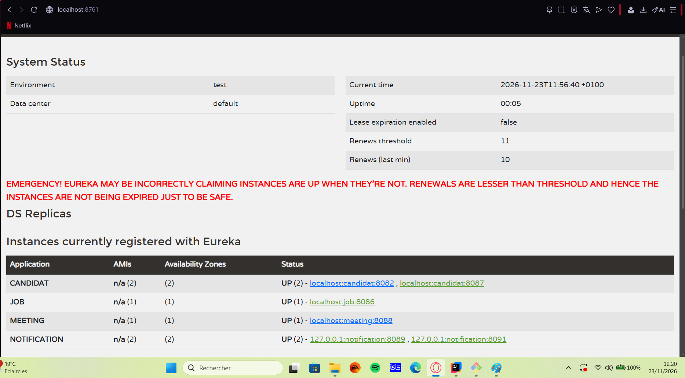

# Architecture Web Distribuée — Ateliers 1 et 2

**Établissement :** ESPRIT  
**Année universitaire :** 2026–2027  
**Matière :** Architecture Web Distribuée

## Membres de l'équipe

- Mohamed Fedi Mhiri
- Mohamed Aziz Bougacha
- Yosr Kobbi
- Yassmine Rahmouni

---

## Présentation du projet

Ce projet regroupe les travaux réalisés dans le cadre de deux ateliers d'Architecture Web Distribuée :

- **Atelier 1 :** Implémentation d'un serveur Eureka.
- **Atelier 2 :** Observabilité des microservices avec Spring Boot Actuator.

L'objectif est de mettre en place une architecture microservices permettant l'enregistrement et la découverte des services, puis de surveiller leur état de santé et de détecter les éventuelles pannes.

## Architecture des microservices

Le projet contient les microservices suivants :

| Microservice | Technologie | Base de données | Port |
|---|---|---|---|
| Discovery | Spring Boot / Eureka Server | — | 8761 |
| Candidat | Spring Boot | H2 | 8082, 8087 |
| Job | Spring Boot | MySQL | 8086 |
| Meeting | Node.js / Express | — | 8088 |
| Notification | Python / FastAPI | — | 8089, 8091 |

Les microservices sont enregistrés dans le serveur Eureka, accessible à l'adresse `http://localhost:8761`.

---

# Atelier 1 — Implémentation Eureka Server

## Objectif

L'objectif de ce premier atelier est de mettre en place un serveur de découverte Eureka permettant aux microservices de s'enregistrer automatiquement et de communiquer dans une architecture distribuée.

## Travail réalisé

### 1. Configuration du serveur Eureka

Nous avons configuré un serveur Eureka avec Spring Boot et Spring Cloud Netflix Eureka Server.

Le serveur démarre sur le port **8761** et fournit un dashboard permettant de visualiser les microservices enregistrés.

### 2. Enregistrement des microservices

Nous avons configuré les clients Eureka pour les microservices :

- Candidat (Spring Boot)
- Job (Spring Boot)
- Meeting (Node.js)
- Notification (Python)

Chaque microservice s'enregistre auprès d'Eureka et apparaît dans le dashboard.

### 3. Création de plusieurs instances

Nous avons lancé plusieurs instances de certains microservices pour vérifier qu'Eureka peut gérer plusieurs instances d'une même application.

| Microservice | Nombre d'instances | Ports |
|---|---|---|
| CANDIDAT | 2 | 8082, 8087 |
| JOB | 1 | 8086 |
| MEETING | 1 | 8088 |
| NOTIFICATION | 2 | 8089, 8091 |
| **Total** | **6** | |

### 4. Résultat — Dashboard Eureka

La capture suivante présente le dashboard Eureka avec les quatre microservices et leurs six instances enregistrées.

Toutes les instances affichent le statut **UP**, ce qui confirme leur enregistrement dans Eureka.

**Résultat :** Nous avons réussi à configurer le serveur Eureka, à enregistrer les microservices et à lancer plusieurs instances pour Candidat et Notification.

---

# Atelier 2 — Observabilité avec Spring Boot Actuator

## Objectif

L'objectif de ce deuxième atelier est de surveiller l'état de santé des microservices, de consulter leurs métriques et de détecter les pannes.

Pour cela, nous avons utilisé Spring Boot Actuator pour les services Java et ajouté des endpoints de santé aux services Node.js et Python.

## Partie 1 — Mise en place de Spring Boot Actuator

Nous avons ajouté la dépendance `spring-boot-starter-actuator` aux microservices Candidat et Job.

Nous avons ensuite configuré les endpoints suivants :

| Endpoint | Fonction |
|---|---|
| `/actuator/health` | Vérifier l'état de santé du microservice |
| `/actuator/info` | Afficher les informations de l'application |
| `/actuator/metrics` | Consulter les métriques disponibles |

Nous avons également activé la transmission de l'état de santé vers Eureka avec la propriété :

`eureka.client.healthcheck.enabled=true`

## Partie 2 — Vérification de l'état de santé

Nous avons testé l'endpoint `/actuator/health` des microservices Candidat et Job.

Les résultats ont confirmé que :

- Le microservice Candidat fonctionne avec sa base H2.
- Le microservice Job fonctionne avec sa base MySQL.
- Actuator permet d'afficher l'état des différents composants.

## Partie 3 — Simulation d'une panne MySQL

Nous avons simulé une panne en arrêtant MySQL depuis XAMPP, tout en laissant le microservice Job en cours d'exécution.

**Résultats observés :**

1. Avant la panne, le microservice Job avait le statut `UP`.
2. Après l'arrêt de MySQL, Actuator a détecté la perte de connexion et affiché `DOWN`.
3. Le statut `DOWN` a également été transmis au dashboard Eureka.
4. Après le redémarrage de MySQL, le microservice Job a retrouvé le statut `UP`.

Cette expérience montre l'intérêt de relier Spring Boot Actuator à Eureka afin de surveiller la santé réelle des microservices.

## Partie 4 — Consultation des informations et métriques

Nous avons utilisé les endpoints `/actuator/info` et `/actuator/metrics` du microservice Candidat.

Les métriques consultées comprennent notamment :

- `jvm.memory.used` : mémoire utilisée par la JVM.
- `http.server.requests` : statistiques des requêtes HTTP.
- `COUNT` : nombre de requêtes.
- `TOTAL_TIME` : durée cumulée des requêtes.
- `MAX` : durée maximale mesurée.

Ces informations permettent de mieux comprendre le fonctionnement et les performances du microservice.

## Partie 5 — Santé des services Node.js et Python

### Microservice Meeting — Node.js / Express

Nous avons ajouté deux endpoints :

- `GET /health` : retourne `{"status":"UP"}`.
- `GET /info` : retourne le nom et la version du service.

Nous avons également configuré `healthCheckUrl` et `statusPageUrl` dans le client Eureka.

**Endpoints :**

- `http://localhost:8088/health`
- `http://localhost:8088/info`

### Microservice Notification — Python / FastAPI

Nous avons ajouté les endpoints :

- `GET /health` : vérifie la disponibilité du microservice.
- `GET /info` : affiche le nom et la version du service.

Nous avons configuré les paramètres `health_check_url` et `status_page_url` lors de l'enregistrement du microservice dans Eureka.

**Endpoints :**

- `http://localhost:8089/health`
- `http://localhost:8089/info`

Nous avons ensuite vérifié les URL enregistrées dans Eureka à l'adresse :

`http://localhost:8761/eureka/apps/NOTIFICATION`

Le registre Eureka confirme que le microservice Notification est enregistré avec le statut `UP` et les bonnes URL de santé et d'information.

---

## Rapport et captures de l'atelier 2

Le compte rendu détaillé contient les captures des tests, les résultats obtenus et les explications des différentes étapes.

**[Consulter le rapport complet de l'atelier 2 (PDF)](documentation/atelier2_actuator.pdf)**

---

## Technologies utilisées

- Java
- Spring Boot
- Spring Cloud Netflix Eureka
- Spring Boot Actuator
- Node.js et Express
- Python et FastAPI
- MySQL et H2
- Maven
- IntelliJ IDEA
- Git et GitHub

## Conclusion générale

Ces deux ateliers nous ont permis de mettre en place et de superviser une architecture microservices.

Le premier atelier nous a permis de comprendre le fonctionnement d'Eureka et de la découverte des services.

Le deuxième atelier nous a montré comment surveiller l'état de santé des microservices, consulter leurs métriques et détecter les pannes grâce à Spring Boot Actuator et aux endpoints de santé personnalisés.

Nous avons ainsi pu observer le fonctionnement d'une architecture distribuée et l'importance de la supervision des services.