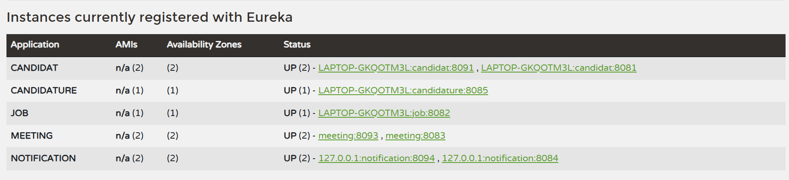

# Atelier Architecture Web Distribuée - Eureka

## Équipe
- Yosr Kobbi
- Mohamed Fedi Mhiri
- Mohamed Aziz Bougacha
- Yassmine Rahmouni

## Architecture

| Microservice | Techno | Port | Nom Eureka |
|---|---|---|---|
| Discovery | Spring Boot | 8761 | - |
| Candidat | Spring Boot + H2 | 8081 (+8091) | CANDIDAT |
| Job | Spring Boot + MySQL | 8082 | JOB |
| Candidature | Spring Boot | 8085 | CANDIDATURE |
| Meeting | Node.js / Express | 8083 (+8093) | MEETING |
| Notification | Python / FastAPI | 8084 (+8094) | NOTIFICATION |

## Lancement

1. Démarrer Eureka (`discovery`).
2. Démarrer Candidat, Job et Candidature.
3. Meeting : `$env:PORT=8083; npm start`
4. Notification : `$env:PORT=8084; python main.py`

## Dashboard Eureka

